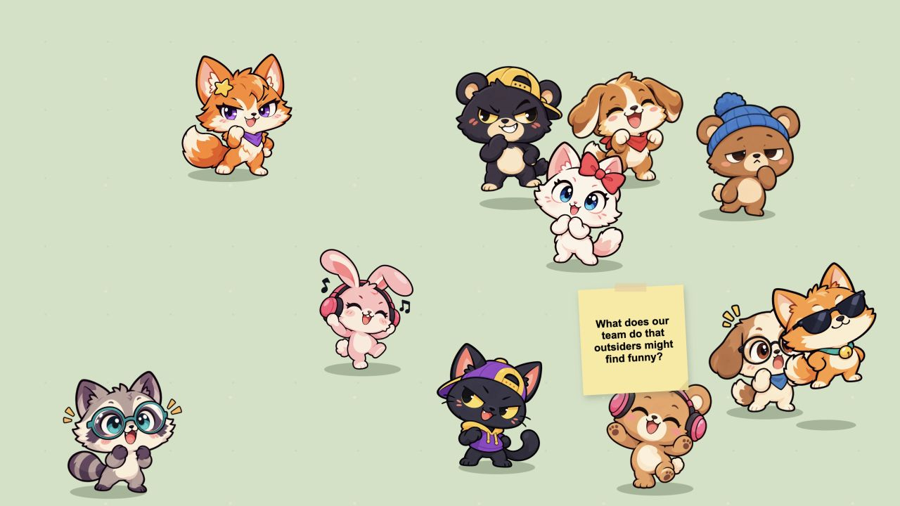

# Fika Friends

A playful, browser-only question game for team Fika. Twelve original animal friends wander and hop around the screen. Pick one to flip it into a post-it with a conversation starter; pick the note again to turn it back.



## Play

Share your screen, invite someone to choose a character, and answer the question together. Anyone can pass. Selecting another character reveals another question. Reload the page to start a fresh round.

The game supports mouse, touch and keyboard: use Tab to select a character, Space or Enter to flip it, and Escape to close an open note. It respects the system's reduced-motion setting.

## Run locally

No build or dependencies are required. From this directory, run:

```sh
python3 -m http.server 8769 --directory dist
```

Open [http://localhost:8769](http://localhost:8769). To host it, upload the contents of `dist/` to a static website host.

## Project structure

```text
dist/
  index.html       Page structure
  style.css        Playground, character and post-it styling
  app.js           Characters, questions, movement and interactions
  assets/          Original character illustrations
```

Edit the `questions` array in `dist/app.js` to change the prompts. Each browser runs its own independent round; there is no backend, shared state or response storage. The font is loaded from Google Fonts when available, with a local fallback.
